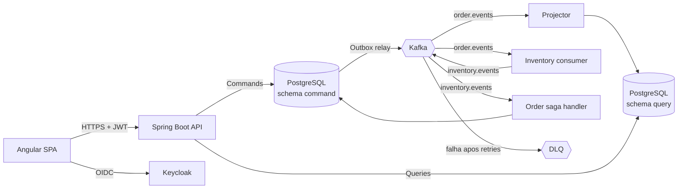

# OrderFlow

Plataforma de gestão de pedidos **event-driven** com **CQRS**, construída com Spring Boot, Angular e Kafka. Projeto de portfólio que demonstra engenharia full stack de nível pleno: arquitetura limpa, mensageria confiável, SQL otimizado, testes automatizados, acessibilidade, segurança e DevOps.


> **Demo:** _TODO (link do deploy ou GIF em `docs/media/demo.gif`)_

---

## Sumário

1. [Objetivo](#1-objetivo)
2. [Stack](#2-stack)
3. [Arquitetura](#3-arquitetura)
4. [Domínio e eventos](#4-domínio-e-eventos)
5. [Estrutura do repositório](#5-estrutura-do-repositório)
6. [Como executar](#6-como-executar)
7. [API](#7-api)
8. [Banco de dados e performance](#8-banco-de-dados-e-performance)
9. [Mensageria: garantias e falhas](#9-mensageria-garantias-e-falhas)
10. [Testes](#10-testes)
11. [Acessibilidade](#11-acessibilidade)
12. [Segurança](#12-segurança)
13. [Observabilidade](#13-observabilidade)
14. [CI/CD e DevOps](#14-cicd-e-devops)
15. [Git Flow e convenções](#15-git-flow-e-convenções)
16. [Roadmap](#16-roadmap)
17. [Decisões arquiteturais (ADRs)](#17-decisões-arquiteturais-adrs)
18. [Definition of Done](#18-definition-of-done)

---

## 1. Objetivo

Cobrir, em um único projeto verificável, as competências esperadas de um(a) desenvolvedor(a) full stack pleno:

| Competência | Evidência no projeto |
|---|---|
| Spring Boot | API REST, Spring Security, Spring Data JPA, Spring Kafka |
| Angular 12+ e TypeScript | Angular 22 standalone e zoneless, signals, TypeScript `strict`, RxJS, lazy loading |
| Testes automatizados | Unitários, integração (Testcontainers), contrato e e2e |
| SQL e performance | Índices, `EXPLAIN ANALYZE` antes/depois, migrations versionadas |
| Mensageria (Kafka) | Outbox, consumers idempotentes, retry e DLQ |
| CQRS | Modelo de escrita e de leitura separados, projeções por eventos |
| Modelagem de dados | Diagrama ER e decisões documentadas |
| Acessibilidade | WCAG 2.2 AA, auditoria com axe e Lighthouse |
| DevOps | Docker, Compose, GitHub Actions, scans de segurança |
| Git / Git Flow | Branches, PRs, Conventional Commits, tags semânticas |

## 2. Stack

| Camada | Tecnologia |
|---|---|
| Backend | Java 21 (Temurin), Spring Boot 4.1, Spring Web, Spring Security (OAuth2 Resource Server), Spring Data JPA (Hibernate 7), Spring Kafka (kafka-clients 4.2), Flyway 12, springdoc-openapi 3 |
| Frontend | Angular 22 (standalone, signals, zoneless, `OnPush`), Angular Material/CDK 22 (M3, temas claro e escuro), angular-auth-oidc-client 22 (OIDC + PKCE), TypeScript 6 strict, RxJS 7, Node 24 |
| Banco | PostgreSQL 16 (schemas `command` e `query`) |
| Mensageria | Apache Kafka 4.4 (KRaft) + Kafka UI (dev) |
| Auth | Keycloak 26 (OIDC/JWT) |
| Testes | JUnit 6 (Jupiter), Mockito 5, AssertJ, Testcontainers 2, ArchUnit 1.5, Jest 30 (jest-preset-angular), Angular Testing Library, Playwright 1.65, axe-core |
| Qualidade | Spotless (google-java-format), Checkstyle, JaCoCo, ESLint 10 (angular-eslint, regras de acessibilidade), Prettier; SonarCloud opcional |
| Observabilidade | Spring Actuator, Micrometer, logs JSON (ECS) com correlation id; Prometheus e Grafana na Fase 9 |
| DevOps | Docker multi-stage (JRE Temurin e nginx sem root), Docker Compose, GitHub Actions, Dependabot, Trivy, gitleaks, CodeQL; OWASP Dependency-Check na Fase 5 |

## 3. Arquitetura

Monólito modular com **dois bounded contexts** (`orders` e `inventory`) comunicando-se por eventos Kafka. CQRS aplicado ao contexto `orders`.



Princípios:

- **Hexagonal por contexto:** `domain` (puro, sem framework) → `application` (casos de uso) → `adapter` (web, persistence, messaging). Regras impostas por **ArchUnit**.
- **Escrita:** comando valida, persiste o agregado e grava o evento na tabela `outbox` na **mesma transação**.
- **Leitura:** projeções desnormalizadas, atualizadas por consumers e otimizadas para as telas.
- **Consistência eventual** entre escrita e leitura; a UI trata o estado `pendente de sincronização`.
- **Saga coreografada** para reserva de estoque (pedido criado → estoque reservado/rejeitado → pedido confirmado/cancelado).

## 4. Domínio e eventos

**Agregado `Order`** — estados: `CREATED → STOCK_RESERVED → CONFIRMED → SHIPPED` e `CREATED|STOCK_RESERVED → CANCELLED`.

| Evento | Produtor | Consumidores |
|---|---|---|
| `OrderCreated` | orders | inventory, projector |
| `StockReserved` | inventory | orders (saga) |
| `StockRejected` | inventory | orders (saga) |
| `OrderConfirmed` | orders | projector |
| `OrderShipped` | orders | inventory (baixa o reservado), projector |
| `OrderCancelled` | orders | inventory (libera estoque), projector |

Envelope padrão do evento:

```json
{
  "eventId": "uuid-v7",
  "type": "OrderCreated",
  "version": 1,
  "aggregateId": "uuid",
  "occurredAt": "2026-01-01T12:00:00Z",
  "correlationId": "uuid",
  "payload": {}
}
```

Tópicos: `order.events`, `inventory.events`, mais tópicos de retry e DLQ por consumer (`<tópico>.<consumer>.retry-<n>` e `<tópico>.<consumer>.dlq`). Chave de partição: `aggregateId` (ordenação por pedido). Contratos versionados em [`docs/events/`](docs/events/order-events.md) ([pedidos](docs/events/order-events.md), [inventário](docs/events/inventory-events.md)).

## 5. Estrutura do repositório

```
orderflow/
├── backend/
│   ├── src/main/java/com/caiodassumpcao/orderflow/
│   │   ├── orders/{domain,application,adapter/{web,persistence,messaging}}
│   │   ├── inventory/{domain,application,adapter/{web,persistence,messaging}}
│   │   └── shared/{config,security,messaging,error,observability}
│   ├── src/main/resources/db/migration/        # Flyway
│   ├── src/test/java/...                       # unit, integration, architecture
│   └── pom.xml
├── frontend/
│   ├── src/app/core/{api,auth,config,http}     # clientes da API, OIDC, config de runtime, erros
│   ├── src/app/shared/                         # componentes e utilitários reutilizáveis
│   ├── src/app/features/{home,orders,admin/{dashboard,inventory,...},forbidden}
│   ├── public/config.json                      # config de runtime em dev
│   ├── e2e/                                    # Playwright + axe, com IdP e API falsos
│   ├── e2e-stack/                              # Playwright contra a stack real (Keycloak, API, Kafka)
│   ├── nginx.conf.template                     # nginx da imagem (CSP e config.json do ambiente)
│   └── package.json
├── infra/
│   ├── docker-compose.yml
│   ├── keycloak/realm-orderflow.json
│   └── observability/{prometheus.yml,grafana/}
├── docs/
│   ├── architecture.md
│   ├── adr/                                    # decisões arquiteturais
│   ├── openapi.yaml                            # contrato da API, gerado e verificado no build
│   ├── api/problems.md                         # catálogo de erros (RFC 9457)
│   ├── messaging.md                            # relay, tópicos, retry/DLQ, métricas
│   ├── events/{schemas,examples}/              # contratos dos eventos (JSON Schema) e exemplos
│   ├── db/{er-diagram.md,performance.md}
│   ├── accessibility.md
│   └── media/
├── .github/
│   ├── workflows/{ci.yml,codeql.yml}
│   ├── dependabot.yml
│   ├── PULL_REQUEST_TEMPLATE.md
│   └── ISSUE_TEMPLATE/
├── CLAUDE.md                                   # contexto e regras para agentes
├── CONTRIBUTING.md
├── SECURITY.md
├── Makefile
├── LICENSE
└── README.md
```

## 6. Como executar

**Pré-requisitos:** Docker 24+ com Compose v2, Java 21, Node 24, GNU Make (no Windows, rode pelo Git Bash ou instale o Make; as receitas usam `sh`).

```bash
git clone https://github.com/caiodassumpcao/orderflow.git
cd orderflow
cp .env.example .env          # ajuste os valores locais
make up                       # sobe Postgres, Kafka, Kafka UI e Keycloak e espera ficarem healthy
make backend-run              # API em http://localhost:8080 (perfil dev)
make frontend-install         # npm ci (primeira vez)
make frontend-run             # SPA em http://localhost:4200
```

| Serviço | URL |
|---|---|
| SPA | http://localhost:4200 |
| API / Swagger UI (perfil dev) | http://localhost:8080/swagger-ui.html |
| Keycloak | http://localhost:8180 |
| Kafka UI | http://localhost:8081 |

Prometheus e Grafana entram na Fase 9. As portas vêm do `.env`; se a 5432 já estiver ocupada, ajuste `POSTGRES_PORT`.

**Comandos úteis (`make help`):** `test`, `test-e2e`, `test-e2e-stack` (e2e contra a stack local no ar), `openapi` (regenera `docs/openapi.yaml`), `lint`, `format`, `build`, `docker-build` (gera as imagens `orderflow-api` e `orderflow-web`), `down`, `clean`.

> Usuários de demonstração (apenas dev) ficam em `infra/keycloak/realm-orderflow.json`: `dev-user` (cliente, papel `USER`) e `dev-admin` (operação, papéis `USER` e `ADMIN`), com as senhas definidas no `.env` (`ORDERFLOW_DEV_USER_PASSWORD`, `ORDERFLOW_DEV_ADMIN_PASSWORD`). Nenhum segredo real é versionado.

**SPA:** a URL da API e o emissor OIDC são lidos de `/config.json` antes do bootstrap ([ADR-0009](docs/adr/0009-spa-oidc-pkce.md)). Em dev vêm de `frontend/public/config.json`; na imagem `orderflow-web`, o nginx gera o arquivo e a CSP (`connect-src`) a partir destas variáveis:

| Variável | Padrão (ambiente local) |
|---|---|
| `ORDERFLOW_API_URL` | `http://localhost:8080` |
| `ORDERFLOW_OIDC_AUTHORITY` | `http://localhost:8180/realms/orderflow` |
| `ORDERFLOW_OIDC_CLIENT_ID` | `orderflow-spa` |

Ex.: `docker run -p 127.0.0.1:4200:8080 orderflow-web:local` serve a imagem na mesma origem do dev server (a registrada no realm).

## 7. API

Documentação interativa em `/swagger-ui.html` e contrato em `/v3/api-docs` (somente no perfil `dev`). O contrato publicado fica em [`docs/openapi.yaml`](docs/openapi.yaml): o build do backend o gera a partir da API e falha se o arquivo versionado estiver diferente (regenere com `make openapi`). O frontend valida contra ele os corpos que envia, as respostas que espera e a API simulada dos e2e.

| Método | Rota | Descrição | Papel |
|---|---|---|---|
| POST | `/api/v1/orders` | Cria pedido (`Idempotency-Key` obrigatório) | USER |
| POST | `/api/v1/orders/{id}/cancel` | Cancela pedido | USER |
| POST | `/api/v1/orders/{id}/ship` | Marca como enviado | ADMIN |
| GET | `/api/v1/orders` | Lista paginada, filtros e ordenação | USER |
| GET | `/api/v1/orders/{id}` | Detalhe do pedido | USER |
| GET | `/api/v1/catalog` | Produtos à venda: nome, preço de catálogo e se há estoque | USER |
| GET | `/api/v1/inventory` | Produtos com preço e quantidades, paginado por SKU | ADMIN |
| GET | `/api/v1/inventory/{sku}` | Consulta estoque (com `ETag`) | ADMIN |
| POST | `/api/v1/inventory` | Cadastra produto | ADMIN |
| POST | `/api/v1/inventory/{sku}/restock` | Repõe estoque (`If-Match` obrigatório) | ADMIN |
| GET | `/api/v1/admin/orders` | Todos os pedidos, com o cliente; filtros por cliente e status | ADMIN |
| GET | `/api/v1/admin/orders/{id}` | Detalhe de qualquer pedido, com o cliente | ADMIN |
| GET | `/api/v1/dashboard/summary` | Pedidos por status, receita confirmada e pedidos por dia | ADMIN |

Todos os endpoints da tabela estão implementados. A coluna **Papel** é exigida pela API (Fase 5): cada endpoint declara o papel com `@PreAuthorize` e um token sem o papel recebe 403. Cancelamento e consultas de pedidos de `USER` são restritos ao dono; outro cliente recebe 404. Comandos (`POST`) são limitados por usuário: rajada de 30, repostos em 1 minuto; acima disso, 429 com `Retry-After`.

**Ciclo do pedido (saga, [ADR-0008](docs/adr/0008-stock-saga-and-catalog-price.md)):** o `POST` responde `CREATED`; em seguida o inventário reserva o estoque e o pedido vira `CONFIRMED`, ou o recusa (sem estoque, SKU inexistente ou preço/moeda diferente do catálogo) e o pedido vira `CANCELLED` com o motivo em `cancellationReason`. Só pedidos `CONFIRMED` podem ser enviados; o cancelamento pelo cliente vale enquanto o pedido está `CREATED`.

**Consultas (modelo de leitura):** `GET /api/v1/orders` lista os pedidos do cliente do mais novo para o mais antigo, com `status` opcional, `limit` de 1 a 100 (padrão 20) e paginação keyset: a resposta traz `nextCursor`, que vai no parâmetro `cursor` da próxima chamada ([ADR-0006](docs/adr/0006-keyset-pagination.md)). As consultas são **eventualmente consistentes** com os comandos ([ADR-0002](docs/adr/0002-cqrs-event-projections.md)): logo após criar ou cancelar, o `GET` pode levar menos de um segundo para refletir a mudança; a resposta do próprio comando já traz o estado novo.

Padrões: versionamento em URL, paginação por cursor/offset documentada, erros em **RFC 9457 (Problem Details)** com catálogo em [`docs/api/problems.md`](docs/api/problems.md), validação com Bean Validation (o erro lista os campos inválidos), cliente sempre identificado pelo `sub` do token.

**Catálogo e estoque:** o cliente monta o pedido a partir de `GET /api/v1/catalog`, que mostra o preço exigido pelo inventário e só diz se há estoque (as quantidades ficam na visão de operação). Listagens de produtos usam paginação keyset pelo SKU (`limit` de 1 a 100, `cursor` = `nextCursor`). A reposição usa **concorrência otimista**: o `ETag` do produto é a versão dele, e `POST .../restock` exige `If-Match` com esse valor. Se o produto mudou (outra reposição ou reservas de pedidos), a resposta é `412` com o `ETag` atual; sem o header, `428`. Assim um reenvio da mesma requisição nunca repõe o estoque duas vezes.

**Dashboard:** `GET /api/v1/dashboard/summary?days=7&timeZone=America/Sao_Paulo` agrega o modelo de leitura: pedidos por status, receita confirmada (pedidos `CONFIRMED` e `SHIPPED`) por moeda e pedidos criados por dia, separados no fuso pedido, sem lacunas.

**Idempotência na criação:** o header `Idempotency-Key` (8 a 128 caracteres) é obrigatório e vale por cliente. Repetir a mesma requisição devolve o pedido original com `201` e `Idempotency-Replayed: true`; reutilizar a chave com outro corpo devolve `422`. Requisições concorrentes com a mesma chave criam um único pedido.

## 8. Banco de dados e performance

- Dois schemas: `command` (agregados + `outbox` + `processed_events`) e `query` (projeções).
- Modelo de escrita atual (V2 e V3): `command.orders` (versão para concorrência otimista), `command.order_lines`, `command.outbox` (payload `jsonb`, `position` sequencial que define a ordem de publicação, índice parcial para eventos pendentes) e `command.idempotency_keys`; `aggregate_version` na outbox (V5) e `command.processed_events` (V4).
- Inventário (V7): `command.stock_items` (preço de catálogo, unidades livres e reservadas), `command.stock_reservations` e itens. A V8 torna a versão da outbox única por tipo de agregado e a V10 adiciona o nome do produto. Em dev, um estoque de demonstração (`SKU-001` a `SKU-005`, com nomes) é carregado de `db/dev-data`.
- Modelo de leitura (V6): `query.order_summaries` e `query.order_items`, mantidos pelo projector; índice `(customer_id, created_at DESC, order_id DESC)` para a paginação keyset.
- Migrations Flyway imutáveis e versionadas.
- Diagrama ER em `docs/db/er-diagram.md`.
- **Estudo de performance** em `docs/db/performance.md`: massa de dados (≥ 1M pedidos), consultas lentas, `EXPLAIN (ANALYZE, BUFFERS)` antes e depois, índices compostos/parciais, paginação keyset.

Resultados (preencher com medições reais):

| Consulta | Antes | Depois | Técnica |
|---|---|---|---|
| Listagem de pedidos por cliente e status | TODO ms | TODO ms | Índice composto `(customer_id, status, created_at DESC)` |
| Dashboard diário | TODO ms | TODO ms | Projeção agregada + índice parcial |
| Paginação profunda | TODO ms | TODO ms | Keyset em vez de `OFFSET` |

## 9. Mensageria: garantias e falhas

- **Transactional Outbox:** o evento é gravado com o agregado; um relay publica no Kafka em ordem de gravação, uma instância por vez, marcando só o que o broker confirmou (at-least-once, sem dual-write).
- **Consumers idempotentes:** tabela `processed_events (event_id, consumer)` com chave primária, gravada na mesma transação que os efeitos do consumer.
- **Retry não bloqueante com backoff** em tópicos próprios de cada consumer (`<tópico>.<consumer>.retry-<n>`) e **DLQ** (`<tópico>.<consumer>.dlq`) após esgotar as tentativas; poison pills vão direto para a DLQ. Métrica `orderflow.messaging.dead.letters` para alerta.
- **Ordenação** garantida por chave de partição (`aggregateId`).
- **Contratos** versionados em JSON Schema ([`docs/events/schemas`](docs/events/schemas)) e testados nos dois lados: cada publisher valida o que grava na outbox, e cada consumer recebe os exemplos de [`docs/events/examples`](docs/events/examples).
- Cenários de falha cobertos em testes (Fase 2): broker indisponível, confirmação parcial do broker, mensagem duplicada, falha passageira recuperada no retry, falha persistente até a DLQ e payload inválido (poison pill). Mensagem fora de ordem é testada em cada consumer (Fases 3 e 4), porque o retry não bloqueante não preserva a ordem no consumer ([ADR-0007](docs/adr/0007-non-blocking-retry.md)).
- Detalhes, configuração e receita para novos consumers em [`docs/messaging.md`](docs/messaging.md).

## 10. Testes

| Nível | Ferramentas | Escopo |
|---|---|---|
| Unitário | JUnit 6, Mockito, AssertJ | Domínio e casos de uso |
| Arquitetura | ArchUnit | Dependências entre camadas e contextos |
| Integração | Testcontainers (Postgres, Kafka) | Persistência, outbox, consumers, retry/DLQ |
| API | `@WebMvcTest`, MockMvc, REST Assured | Contratos HTTP, segurança, erros |
| Frontend unitário | Jest (jest-preset-angular), Angular Testing Library | Componentes, serviços, guards, interceptação de erros |
| Contrato | JSON Schema (networknt), OpenAPI + ajv | Eventos (produtores e consumidores), `docs/openapi.yaml` contra a API, requisições e respostas da SPA contra o contrato |
| E2E | Playwright | Fluxos de cliente e operação com provedor OIDC e API simulados (validados contra o contrato); fluxos críticos na stack real (Keycloak, API, Kafka e imagem nginx) no job `e2e-stack` |
| Acessibilidade | axe-core (Playwright) | Todas as telas e diálogos, nos temas claro e escuro, sem violações WCAG 2.2 AA |

Metas: cobertura backend ≥ 80% (linhas) e ≥ 70% (branches) no domínio e aplicação, frontend ≥ 80%; CI falha abaixo disso. Execução: `make test`.

## 11. Acessibilidade

Meta **WCAG 2.2 nível AA**.

- HTML semântico, landmarks, hierarquia de headings.
- Navegação 100% por teclado, foco visível, skip link.
- Formulários com `label`, mensagens de erro associadas (`aria-describedby`) e `aria-live` para feedback.
- Contraste mínimo 4.5:1, suporte a `prefers-reduced-motion` e zoom de 200%.
- Tabelas com `caption`/`scope`; status nunca comunicado só por cor.
- Numa SPA a página não recarrega: a cada navegação o foco vai para o conteúdo principal e o título da aba muda; diálogos de confirmação prendem o foco e o devolvem ao botão de origem; o andamento da saga de estoque é anunciado numa região `role="status"`.
- Auditoria com axe em todas as telas no CI e Lighthouse na imagem de produção (acessibilidade 100); verificações, resultados e roteiro de teste manual com leitor de tela em [`docs/accessibility.md`](docs/accessibility.md).
- Teste manual com NVDA ou VoiceOver documentado.

## 12. Segurança

- **AuthN/AuthZ** ([ADR-0005](docs/adr/0005-keycloak-identity.md)): OIDC via Keycloak (Authorization Code + PKCE na SPA). O JWT é validado no backend (assinatura, expiração, emissor e cliente autorizado `azp`). RBAC com os papéis do realm (`USER`, `ADMIN`) declarados em cada endpoint com `@PreAuthorize`; uma regra do ArchUnit falha o build para endpoints sem papel. A propriedade do recurso é verificada nos casos de uso.
- **SPA** ([ADR-0009](docs/adr/0009-spa-oidc-pkce.md)): cliente público com PKCE S256, tokens no `sessionStorage`, renovação por refresh token (sem iframe), token anexado só às chamadas da API; CSP da imagem com `script-src 'self'` e `connect-src` restrito à API e ao realm.
- **Validação** de entrada em todas as bordas; sem SQL dinâmico concatenado.
- **Headers:** CSP, HSTS, X-Content-Type-Options, Referrer-Policy; CORS restrito por ambiente.
- **Segredos** via variáveis de ambiente; `.env.example` sem valores reais; scan com gitleaks.
- **Supply chain:** Dependabot, OWASP Dependency-Check, Trivy (imagens), CodeQL (SAST).
- **Containers:** imagens mínimas, usuário não-root, `read_only` quando possível.
- **Rate limiting** por usuário nos comandos (token bucket em memória, por instância; 429 com `Retry-After`) e logs sem payloads de mensagens nem segredos.
- **Superfície pública:** só os probes `/actuator/health/liveness` e `/readiness`, sem detalhes; health completo, métricas e Swagger exigem token fora do perfil `dev`.
- Política de divulgação em [`SECURITY.md`](SECURITY.md). Base: OWASP ASVS e Top 10.

## 13. Observabilidade

- Logs estruturados em JSON com `correlationId` propagado HTTP → evento → consumer.
- Métricas Micrometer: latência por endpoint, lag de consumer, tamanho da outbox, mensagens em DLQ.
- Health checks (`liveness`/`readiness`) via Actuator.
- Dashboards Grafana versionados em `infra/observability/grafana/`.

## 14. CI/CD e DevOps

- **`ci.yml`** (PR e push em `main`/`develop`): backend (`mvnw verify`: testes unitários e de integração, ArchUnit, JaCoCo, Spotless, Checkstyle) → frontend (ESLint, Prettier, Jest com cobertura, build) → e2e Playwright + axe → build das imagens Docker com scan do Trivy. Um job de segurança roda gitleaks e Trivy no repositório (dependências, misconfig, segredos).
- **`codeql.yml`** (PR, push e semanal): SAST de Java, TypeScript e Actions.
- **Dependabot** semanal para actions, Maven, npm e imagens base.
- Actions fixadas por SHA de commit; token do workflow somente leitura por padrão.
- **`dependency-check.yml`** (semanal, manual e em PRs que mudam o `pom.xml`): OWASP Dependency-Check das dependências de produção, falhando com CVSS ≥ 7 e publicando no code scanning. Precisa do secret `NVD_API_KEY`; sem ele, o job avisa e termina.
- Release: tag semântica `vX.Y.Z` publica imagens e changelog (Conventional Commits), na Fase 10.

## 15. Git Flow e convenções

- Branches: `main` (produção), `develop` (integração), `feature/*`, `release/*`, `hotfix/*`.
- Todo trabalho entra via **Pull Request** para `develop` com template e CI verde.
- **Conventional Commits:** `feat:`, `fix:`, `docs:`, `test:`, `refactor:`, `chore:`, `ci:`, `perf:`.
- Tags SemVer e `CHANGELOG.md` gerado.
- Proteção de branch em `main` e `develop`: PR obrigatório, CI obrigatório, sem force-push.

Detalhes em [`CONTRIBUTING.md`](CONTRIBUTING.md).

## 16. Roadmap

- [x] **Fase 0 — Fundação:** repositório, Git Flow, Compose, esqueletos backend/frontend, CI base, ADR-0001
- [x] **Fase 1 — Domínio de pedidos (escrita):** agregado, comandos, outbox, migrations, testes de domínio
  - Endpoints de escrita incluídos nesta fase (criar, cancelar, enviar), com idempotência e Problem Details.
- [x] **Fase 2 — Mensageria:** relay Kafka, tópicos, consumers idempotentes, retry/DLQ
  - Entrega a infraestrutura (relay, tópicos, idempotência, retry/DLQ, métricas) validada com um consumer de teste; os primeiros consumers reais são o projector (Fase 3) e o inventário (Fase 4).
- [x] **Fase 3 — CQRS (leitura):** projeções, endpoints de consulta, paginação keyset
  - Projector tolerante a eventos repetidos e fora de ordem (via `aggregateVersion`), com teste dedicado; consultas restritas ao dono.
  - Índices além do da paginação keyset ficam para o estudo da Fase 8.
- [x] **Fase 4 — Inventário e saga:** reserva/rejeição/liberação de estoque
  - Saga coreografada entre pedidos e inventário; o inventário é a fonte de verdade do preço e recusa pedidos com preço ou moeda diferentes do catálogo ([ADR-0008](docs/adr/0008-stock-saga-and-catalog-price.md)).
  - Ainda não há endpoint para cadastrar produtos ou repor estoque (em dev há um estoque de demonstração); entra com as telas de administração (Fase 6), protegido pelo RBAC da Fase 5.
- [x] **Fase 5 — Segurança:** Keycloak, RBAC, headers, rate limit, scans no CI
  - RBAC com os papéis do Keycloak em todos os endpoints, visão de administrador (`/api/v1/admin/orders`), validação do cliente do token (`azp`) e rate limit por usuário nos comandos.
  - Probes `liveness`/`readiness` públicos e sem detalhes; `HEALTHCHECK` na imagem da API.
  - OWASP Dependency-Check no CI (`dependency-check.yml`); requer o secret `NVD_API_KEY`.
  - CSRF está desligado no `SecurityConfig` porque a API é stateless e autenticada só por `Authorization: Bearer` (sem cookie de sessão, não há vetor de CSRF); o CodeQL aponta isso como `java/spring-disabled-csrf-protection`. Reativar o CSRF se a autenticação passar a usar cookie (ex.: BFF).
- [x] **Fase 6 — Frontend:** login OIDC, listagem, detalhe, criação, dashboard
  - Login OIDC com PKCE na SPA ([ADR-0009](docs/adr/0009-spa-oidc-pkce.md)); telas do cliente (pedidos, criação com preço de catálogo, detalhe que acompanha a saga e tolera o atraso da projeção, cancelamento) e da operação (painel, todos os pedidos com envio, estoque com cadastro e reposição).
  - Backend: catálogo para clientes, cadastro de produto e reposição com `If-Match` (V10: nome do produto) e `GET /api/v1/dashboard/summary`.
  - Imagem `orderflow-web` configurada em runtime (`config.json` e CSP gerados das variáveis `ORDERFLOW_*`).
  - E2E com provedor OIDC e API falsos e axe em todas as telas.
- [ ] **Fase 7 — Qualidade:** e2e, acessibilidade, cobertura, contract tests
  - E2E na stack real no CI (job `e2e-stack`): login no Keycloak, compra confirmada pela saga e enviada, recusa por falta de estoque, cadastro e reposição de produto.
  - Contrato OpenAPI publicado em `docs/openapi.yaml` e verificado no build; SPA e API simulada validados contra ele. Contratos de eventos em JSON Schema, com testes de produtor e consumidor.
  - `docs/accessibility.md` com as verificações automáticas, o resultado do Lighthouse e o roteiro de teste manual com leitor de tela (execução manual, registrada no próprio documento).
  - Mensagem quando o serviço de login está fora do ar; indicador de carregamento estável e com movimento reduzido.
- [ ] **Fase 7.1 — Design e UX:** revisão visual da plataforma (cabeçalho e navegação, espaçamentos, cards, tabelas, telas de pedido e de operação), mantendo WCAG 2.2 AA e os e2e/axe verdes
  - O indicador de carregamento já foi corrigido na Fase 7 (espaço fixo, sem piscar em respostas rápidas e texto estático com movimento reduzido).
- [ ] **Fase 8 — Performance SQL:** massa de dados, índices, `docs/db/performance.md`
  - Definir retenção e limpeza de `command.idempotency_keys` e das linhas já publicadas de `command.outbox`.
  - O dashboard agrega `query.order_summaries` a cada requisição; medir e, se preciso, trocar por uma projeção agregada.
- [ ] **Fase 9 — Observabilidade e deploy:** métricas, Prometheus, Grafana, dashboards, deploy/demo
  - Alertas sobre `orderflow.messaging.dead.letters` e o crescimento de `orderflow.outbox.pending`; ferramenta para reprocessar DLQs.
- [ ] **Fase 10 — Validação de segurança e release:** revisão final antes da v1.0.0
  - Scans completos (CodeQL, Trivy, Dependency-Check, gitleaks, `npm audit`) sem HIGH/CRITICAL e com as moderadas tratadas ou justificadas.
  - `npm audit`: 19 vulnerabilidades moderadas em dependências de desenvolvimento (`glob`/`minimatch` puxados pelo `test-exclude` do Jest). Atualizar quando o Jest publicar versão corrigida ou aplicar `overrides` no `package.json`.
  - Remover os overrides de `lz4-java` e `snappy-java` no `backend/pom.xml` quando o Spring Boot gerenciar versões corrigidas.
  - Voltar a imagem do nginx para a linha estável (1.30.7+ ou sucessora) quando houver imagem publicada; hoje usa a mainline 1.31.7 por causa de CVEs críticas na 1.30.6.
  - Revisar CSP, headers e CORS de produção (a CSP da SPA ainda tem `style-src 'unsafe-inline'` para os estilos que o Angular injeta); revisão OWASP ASVS / Top 10; atualizar `SECURITY.md`.
  - Reavaliar tokens no `sessionStorage` da SPA contra um BFF com cookie `HttpOnly` ([ADR-0009](docs/adr/0009-spa-oidc-pkce.md)).
  - Rate limit distribuído (ex.: Redis) se a API rodar com mais de uma instância; o atual vale por instância.
  - Tag `v1.0.0`, publicação das imagens e changelog.

## 17. Decisões arquiteturais (ADRs)

Registradas em `docs/adr/` (formato MADR). Iniciais:

- [ADR-0001](docs/adr/0001-modular-monolith.md): Monólito modular em vez de microsserviços
- [ADR-0002](docs/adr/0002-cqrs-event-projections.md): CQRS com projeções por eventos
- [ADR-0003](docs/adr/0003-transactional-outbox.md): Transactional Outbox em vez de dual-write
- [ADR-0004](docs/adr/0004-kafka-kraft.md): Kafka (KRaft) como broker
- [ADR-0005](docs/adr/0005-keycloak-identity.md): Keycloak para identidade
- [ADR-0006](docs/adr/0006-keyset-pagination.md): Paginação keyset nas listagens grandes
- [ADR-0007](docs/adr/0007-non-blocking-retry.md): Retry não bloqueante por consumer, com DLQ
- [ADR-0008](docs/adr/0008-stock-saga-and-catalog-price.md): Saga coreografada de estoque, com o preço validado pelo inventário
- [ADR-0009](docs/adr/0009-spa-oidc-pkce.md): Login OIDC na própria SPA, com PKCE (sem BFF)

## 18. Definition of Done

Uma tarefa só está concluída quando:

- [ ] Critérios de aceite atendidos e código revisado via PR
- [ ] Testes novos/ajustados passando e cobertura mantida
- [ ] Lint, format e ArchUnit sem violações
- [ ] Sem vulnerabilidades altas/críticas nos scans
- [ ] Acessibilidade verificada (quando houver UI)
- [ ] Documentação e ADR atualizados
- [ ] Migrations versionadas e reversíveis em dev
- [ ] CI verde

---

## Licença

[MIT](LICENSE) © Caio Dassumpção
