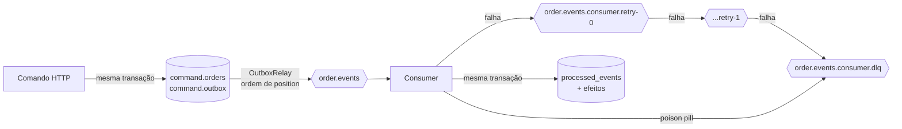

# Mensageria

Como os eventos saem do banco, chegam ao Kafka e são consumidos com segurança. Decisões em [ADR-0003](adr/0003-transactional-outbox.md) (outbox), [ADR-0004](adr/0004-kafka-kraft.md) (broker) e [ADR-0007](adr/0007-non-blocking-retry.md) (retry). Contratos dos eventos em [`events/`](events/order-events.md).



## Publicação (relay)

- O caso de uso grava agregado e eventos em `command.outbox` na mesma transação.
- `OutboxRelay` roda a cada `orderflow.messaging.relay.interval` (500 ms) e publica as linhas pendentes em ordem de `position`, até `batch-size` (100) por lote.
- **Uma instância por vez:** um advisory lock transacional do PostgreSQL elege quem publica. Duas instâncias publicando lotes em paralelo poderiam inverter eventos de um mesmo pedido.
- **Marcação só após confirmação:** `published_at` só é gravado depois do `ack` do broker (`acks=all`, produtor idempotente). Na primeira falha o lote para e só o prefixo confirmado é marcado; a próxima varredura recomeça do primeiro pendente.
- **Mensagem:** chave = `aggregateId` (todos os eventos de um pedido na mesma partição, em ordem), valor = envelope JSON do contrato.
- **Garantia:** at-least-once. Se o relay cair entre a confirmação do broker e a marcação, o evento é publicado de novo; os consumers deduplicam pelo `eventId`.
- **Broker indisponível:** o envio desiste em `max.block.ms` (10 s), o evento continua pendente e a API segue funcionando.

## Tópicos

| Tópico | Quem cria | Conteúdo |
|---|---|---|
| `order.events` | aplicação (`OrderTopics`), na subida | eventos do agregado Order |
| `order.events.<consumer>.retry-<n>` | aplicação, ao registrar o consumer | novas tentativas do consumer |
| `order.events.<consumer>.dlq` | aplicação, ao registrar o consumer | mensagens que o consumer desistiu de processar |

O broker não cria tópicos sozinho (`auto.create.topics.enable=false`). Partições: `orderflow.messaging.topics.partitions` (3). Réplicas: `KAFKA_REPLICATION_FACTOR`, obrigatório fora de dev (use 3 em produção).

Os tópicos de retry e DLQ levam o nome do consumer porque cada consumer group precisa dos seus: se o projector e o inventário compartilhassem `order.events.retry-0`, um receberia as novas tentativas do outro.

## Consumo

Consumers atuais:

| Consumer | Tópico | O que faz |
|---|---|---|
| `order-projector` | `order.events` | mantém o modelo de leitura (`query.order_summaries`, `query.order_items`), aplicando só eventos com `aggregateVersion` mais nova que a já aplicada |
| `inventory` | `order.events` | reserva ou recusa o estoque (`OrderCreated`), devolve (`OrderCancelled`) e dá baixa (`OrderShipped`); publica em `inventory.events` |
| `order-saga` | `inventory.events` | confirma (`StockReserved`) ou cancela (`StockRejected`) o pedido |

O nome do consumer é também o group id e o sufixo dos seus tópicos de retry e DLQ. Qualquer consumer pode ser desligado com `orderflow.messaging.consumers.<nome>.enabled=false` (útil em incidentes e em testes que isolam um fluxo).

Todo consumer segue a mesma receita:

```java
@Component
class OrderProjector {

  static final String NAME = "projector";

  private final IdempotentEventProcessor processor;
  private final DeadLetters deadLetters;

  @OrderflowRetryableTopic(retryTopicSuffix = ".projector.retry", dltTopicSuffix = ".projector.dlq")
  @KafkaListener(topics = OrderTopics.ORDER_EVENTS, groupId = NAME)
  void on(ConsumerRecord<String, String> record) {
    processor.process(NAME, record.value(), envelope -> {
      // efeitos do consumer; rodam na mesma transação que a marcação em processed_events
    });
  }

  @DltHandler
  void onDeadLetter(
      ConsumerRecord<String, String> record,
      @Header(name = KafkaHeaders.EXCEPTION_MESSAGE, required = false) byte[] reason) {
    deadLetters.record(NAME, record.topic(), record.key(), reason);
  }
}
```

- **Idempotência:** `IdempotentEventProcessor` grava `(eventId, consumer)` em `command.processed_events` e executa o handler na mesma transação. Reentregas são descartadas; se o handler falhar, nada fica gravado e a mensagem vai para o retry.
- **Retry:** backoff exponencial em tópicos próprios (`attempts` 4, `initial-delay-ms` 1000, `multiplier` 2.0, `max-delay-ms` 10000, em `orderflow.messaging.retry.*`). Enquanto uma mensagem espera, as seguintes da partição continuam sendo processadas.
- **Poison pill:** mensagem que não é um envelope válido lança `PoisonMessageException` e vai direto para a DLQ, sem retry.
- **Ordem:** como o retry não bloqueia a partição, um consumer pode receber `OrderCancelled` antes de um `OrderCreated` que está em retry. **Todo consumer precisa tolerar eventos fora de ordem** (ex.: projeções versionadas, ignorar transições que já aconteceram). Ver ADR-0007.
- **Rastreabilidade:** o `correlationId` do envelope vai para o MDC, então os logs do consumer têm o mesmo id da requisição HTTP de origem.

## Métricas

| Métrica | Tipo | Uso |
|---|---|---|
| `orderflow.outbox.pending` | gauge | eventos ainda não publicados; alerta se crescer continuamente |
| `orderflow.outbox.published` | counter | eventos confirmados pelo broker |
| `orderflow.outbox.publish.failures` | counter | falhas de publicação (broker fora, timeout) |
| `orderflow.messaging.processed{consumer}` | counter | eventos processados pela primeira vez |
| `orderflow.messaging.duplicates{consumer}` | counter | reentregas descartadas |
| `orderflow.messaging.dead.letters{consumer}` | counter | mensagens enviadas à DLQ; alerta a cada incremento |

Expostas em `/actuator/prometheus`. Dashboards e alertas entram na Fase 9.

## Operação

- Ver tópicos e mensagens: Kafka UI em `http://localhost:8081`.
- Reprocessar uma DLQ: corrigir a causa e republicar as mensagens. O caminho mais simples é pela própria outbox: `UPDATE command.outbox SET published_at = NULL WHERE aggregate_id IN (...)` devolve os eventos ao relay, que os publica de novo com o envelope atual. A deduplicação por `eventId` torna a republicação segura para quem já os processou. Uma ferramenta própria entra na Fase 9.
- Exemplo real: os eventos publicados na Fase 2, antes de o envelope ter `aggregateVersion`, foram para a DLQ do projector como mensagens inválidas. Republicá-los pela outbox (com a versão preenchida pela migration V5) os projetou corretamente.
- O motivo da falha vai no cabeçalho `kafka_exception-message` da mensagem na DLQ (bytes UTF-8) e no log de `DeadLetters`.
- Mensagens publicadas antes de o envelope ter `aggregateVersion` (só existem em ambientes de dev da Fase 2) são rejeitadas como inválidas por todo consumer que lê o tópico desde o início; as cópias republicadas pela outbox já foram processadas.
- Reconstruir a projeção do zero: esvaziar `query.order_summaries` (os itens saem em cascata), remover as linhas do consumer em `processed_events` e republicar a outbox.
